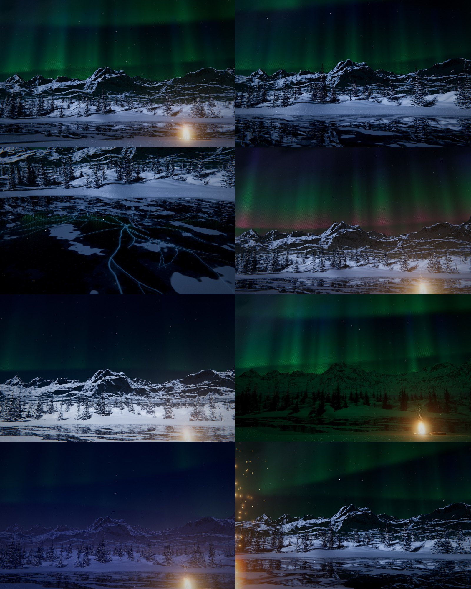

# Aurora

A frozen lake under the northern lights, rendered live in the browser with three.js (WebGL2). The mountains, pines, ice, sky, aurora and sound are all generated in code. No models, textures or audio files.

**Live:** https://afthab-in.github.io/aurora/



## Run it

```bash
npm install
npm run dev
```

Then open http://localhost:5243.

## Things to do

- **Click the ice:** it cracks. A branching fracture spreads out, glows blue, then settles into white lines.
- **Click a pine:** it shakes and drops its snow. While it's snowing, the tree slowly gathers snow again.
- **Click the fire:** puts it out or lights it again.
- **Press and hold on the sky:** the aurora surges, and ripples run out from your pointer.
- **Space:** a gust of wind lifts snow off the ground and bends the trees.
- **Drag, scroll:** orbit and zoom. `1` to `6` play camera shots, `0` stops, `H` hides the bar.

Bottom bar:
- **Grade:** colour look
- **Sky:** Aurora night, Moonless, Full moon, Polar twilight
- **Aurora:** Green veil, Green + pink, Violet storm, Crimson crown
- **Snow:** Clear, Flurries, Snowfall
- **Shot:** camera flights
- **Sound:** on or off
- Aurora activity and film grain sliders

## How it is built

| File | What it does |
|---|---|
| `src/heightfield.ts` | One GLSL height function (a lake basin, forest hills, a ring of ridged mountains), baked on the GPU into an inner and an outer texture. The CPU reads back copies for placing trees and for picking. |
| `src/terrain.ts` | Two meshes share one snow shader: a dense grid around the lake and a polar ring for the mountains, so the skyline stays smooth. Wind-carved snow ridges, rock on steep faces, glitter. |
| `src/landshadow.ts` | Mountain and hill shadows, ray-marched into a texture only when the light moves. |
| `src/sky.ts` | Night gradient, stars, Milky Way, moon, and the aurora. The aurora is ray-marched through a layer of sky, at half resolution, in its own pass. Night presets and aurora palettes ease from one to the next. |
| `src/ice.ts` | Black ice with planar reflections, bubbles at three depths, faint fracture planes, crisp snow drifts, and the crack layer your clicks draw into. |
| `src/pines.ts` | Procedural spruces: drooping branch tiers with upturned tips, a needle texture drawn on a canvas, snow on the upper faces, and per-tree snow and shake state. |
| `src/fire.ts` | Stone ring, logs with glowing coals, flame cards, GPU embers, a flickering warm light. |
| `src/fx.ts` | Falling snow that wraps around the camera, plus pooled bursts: snow off trees, ice chips, sparks. |
| `src/audio.ts` | WebAudio synth: wind, the "singing" crack of lake ice, snow landing, fire crackle, an aurora shimmer. |
| `src/interact.ts` | Picking against the heightfield, the ice, the trees (as cones) and the fire. |
| `src/post.ts` | Bloom, ACES tone mapping, grade, film grain. |
| `tools/shoot.cjs` | Headless Chrome (GPU) screenshots and timings for QA. Set `PW_CORE` to a playwright-core path if it isn't installed here. |

`shots/` holds reference frames from the first build. Every push to `main` builds and deploys to GitHub Pages (`.github/workflows/pages.yml`).
